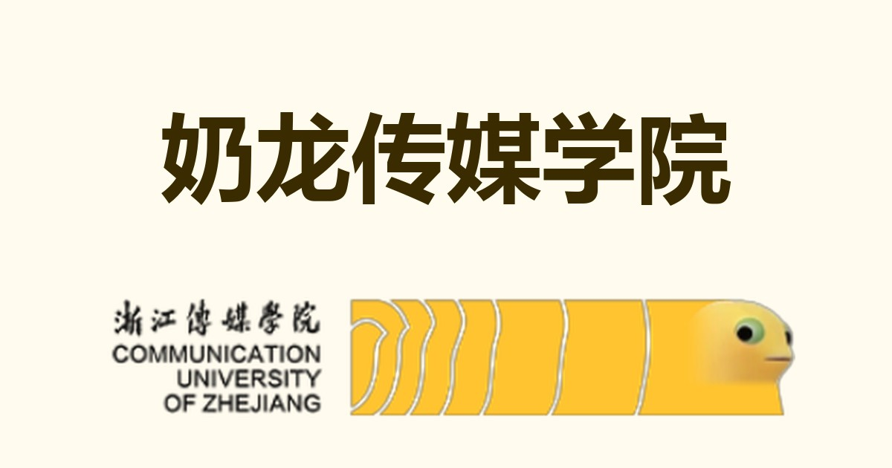

# 奶龙传媒学院

本仓库是 [www.奶龙传媒学院.com](https://www.xn--dpqu5wnyaiyf17sktl.com/) 的源代码。站点部署于阿里云 ESA，为纯静态网页（HTML / CSS / JS，零依赖、无构建步骤），仓库更新后自动同步部署。

页面复刻自 [www.中国奶龙大学.com](https://www.xn--fiqs8srwb9iv6f6w9n.com/) 的开场动画与全屏扇形校区转盘，校名改为「奶龙传媒学院」。



## 免责声明

本站仅供娱乐，与浙江传媒学院官方无任何关系。站内素材照搬自原站，后续将逐步替换为原创内容。

## 特性

- 开场动画：旋转文字环 + 进度条，点击或按任意键跳过
- 全屏扇形校区转盘：缓慢公转、截图反向自转保持静止、悬停高亮、选中跳转
- 渐进加载：模糊占位图（LQIP 内联，零额外请求）→ 清晰 WebP 淡入，首屏约 300KB
- 深色模式、`prefers-reduced-motion` 降级、无 JS 静态兜底
- SEO 基础设施：robots.txt、sitemap.xml、PWA manifest

## 目录

```
index.html              单页主体（全部逻辑）
assets/                 站点素材（ring / core / og / favicon、压缩后的校区图）
resource/               校区原图、QQ 群图
robots.txt  sitemap.xml  manifest.json
```

## 自定义

改校区只需编辑 `index.html` 中的 `CAMPUSES` 数组（支持 2 / 3 / 4 / 5 个，转盘几何自动重算）：

```js
const CAMPUSES = [
  { name: "媒体工程学院", img: "assets/campus-mtgc.webp", href: "https://mtgc.cuz.edu.cn/" },
  { name: "总校官网",     img: "assets/campus-cuz.webp",  href: "https://www.cuz.edu.cn/" },
  // { name: "新校区",    img: "assets/campus-xxx.webp", href: "https://..." },
];
```

换校名改 `UNIV` 常量；换素材直接覆盖 `assets/` 中同名文件。

## 贡献

欢迎浙传的奶龙爱好者参与贡献 —— 前端代码（动画、性能、可访问性）与艺术设计（校徽 logo、校区图等）均可提交 Issue 或 PR。

<div align="center">

<p>奶龙交流 QQ 群</p>
</div>

## 待办

- [ ] logo：专属校徽设计（目前暂用原站素材）
- [ ] 代码：动画细节、性能与可访问性打磨
